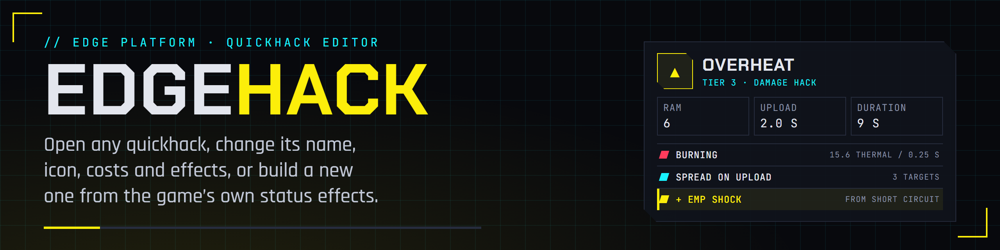
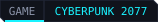
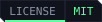

<p align="center">
  
</p>

<p align="center">
  <a href="https://edgemodders.github.io/EDGEhack/"></a>
  
  
  
  <a href="LICENSE"></a>
</p>

A quickhack editor for Cyberpunk 2077, as a VS Code extension in the EDGE family:

- **Open any quickhack**, from its own Quickhacks view or by clicking one in REDcode or another EDGE tool, and see everything about it in plain words: name, icon, tier, RAM, upload time, cooldown, duration, damage and the effects it applies.
- **Change it:** texts, icons, costs and numbers, for one tier or the whole family.
- **Make new ones:** start from a game quickhack and add buffs, debuffs and attack features, taken from other quickhacks or from the game's status effects that work on enemies.
- **A mod you can read:** EDGEhack writes TweakXL and ArchiveXL files into your REDcode project, and REDcode packs and plays it.

**[Docs](https://edgemodders.github.io/EDGEhack/)** &middot; [Design](docs/design.md) &middot; [Changelog](CHANGELOG.md) &middot; [Tests](docs/testing.md)

> [!NOTE]
> **Status: design draft (H0), 2026-11-04.** The repo, the release workflow, the brand and an empty extension with its three views (Desk, Library, Quickhacks) are in place. The design, with how the game builds a quickhack and the phases H1 to H6, waits for the owner's review: [docs/design.md](docs/design.md). Nothing is released yet.

## Repo layout

| Folder | What |
|---|---|
| `src/` | The extension: `extension.ts` (the views), `quickhack.ts` (families and tiers from record names) |
| `test/` | Unit tests, `npm test` |
| `docs/` | The docs site, published at https://edgemodders.github.io/EDGEhack/ |
| `nexus/` | The Nexus Mods page's source and upload settings |
| `tools/` | `brand/` renders the banner, icon and badges; `release-notes.mjs` and `nexus-zip.mjs` serve the Release workflow; `release/readme-check.mjs` and `nexus/` are shared with the other EDGE repos |

## Build

```powershell
npm install
npm run typecheck
npm run build
npm test
```

Press F5 in VS Code to run it. More in [Dev setup](docs/dev-setup.md).

| You need | Why |
|---|---|
| Windows 10 or 11, Cyberpunk 2077 on PC | EDGEhack reads the game's TweakDB |
| VS Code 1.90 or later | EDGEhack is a VS Code extension |
| REDcode, with REDbridge | The game folder, TweakDB reads, the project, Pack and Play (from H1) |
| TweakXL and ArchiveXL in the game | For the mods EDGEhack makes |

Not affiliated with CD Projekt RED.
